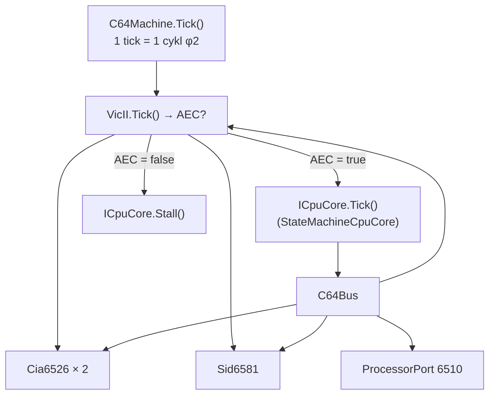
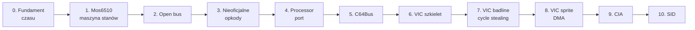

# Plan implementacji: C64 cycle-exact (6510 + VIC-II)

Status: **w realizacji** (szkielet maszyny działa; zgodność z zestawami referencyjnymi jeszcze niepotwierdzona — patrz sekcja „Stan realizacji", stan na 2026-10-21) · Target: **PAL 6569R5** · Zakres: **poziom 3** (gry + większość dem)

---

## Stan realizacji

Stan na 2026-10-21, ocena na podstawie kodu w `src/Core/C64` i testów w
`tests/VibeEmulator.Core.Tests/C64/` (testów nie uruchamiano przy sporządzaniu tej tabeli).
Faza jest **zrobiona** tylko wtedy, gdy spełnione jest jej kryterium akceptacji z sekcji 3;
w przeciwnym razie jest **w toku** z wyszczególnionymi brakami.

| faza | status | co jest (pliki) | czego brakuje do akceptacji |
|---|---|---|---|
| 0. Fundament czasowy | w toku (prawie) | `C64Machine.Tick()`/`RunFrame()` w `C64Machine.cs`; `VicII.Tick()`; test `Frame_HasExactly19656Cycles` w `C64MachineTests.cs` | test 100 klatek bez dryfu; licznik cykli jest w `ICpuCore.Cycles` (`long`), nie w `CpuState.Cycles`; `VicII.Tick()` jest już pełniejszy niż „pusty" |
| 1. CPU jako maszyna stanów | w toku (etap 2a zrobiony) | `src/Mos6502/StateMachineCpuCore.cs` (`Tick()` = 1 cykl, `Stall()`, RMW z dwoma zapisami, JAM zamiast wyjątku, dummy read w 2. cyklu instrukcji jednobajtowych, adres dummy przy indeksowaniu zależny od wariantu), `src/Mos6502/CpuVariant.cs` (NMOS 6502: 57 wpisów z BRK; 65C02: 63), `src/Mos6502/Disassembler.cs`; testy wektorowe `tests/VibeEmulator.Mos6502.Tests/SingleStepVectorTests.cs` (118 próbek po 100 testów, bez `Skip`) | **zweryfikowane pełnymi wektorami** (10 000 testów na opkod): wszystkie 56 opkodów NMOS i 62 opkody 65C02 (bez BRK, `00`). Brakuje (94 z 151 oficjalnych NMOS): logika i porównania (AND/ORA/EOR, BIT, CMP/CPX/CPY); ADC/SBC w pozostałych trybach; przesunięcia i rotacje (ASL/LSR/ROL/ROR) oraz INC/DEC w `zp,X`/`abs,X`; rozgałęzienia (branch); stos (PHA/PLA/PHP/PLP); JSR/RTS/RTI; pełny BRK i przerwania; JMP (ind.); tryb dziesiętny ADC/SBC |
| 2. Open bus | w toku (częściowo) | `C64Bus.OpenBus` (aktualizowany odczytami), `$DE00-$DFFF` zwraca open bus; test `OpenBus_ReturnsLastValueOnBus`; `ProcessorPort.ReadData()` | `$D400-$D7FF` (SID) zwraca zawartość rejestrów, nie open bus; zapisy nie aktualizują `OpenBus`; `$00`/`$01` nie są podpięte do `C64Bus` (patrz faza 4); brak testu „dwa różne poprzednie odczyty dają różne wyniki" dla `LDA $D419` |
| 3. Nieoficjalne opkody | nie rozpoczęta | — (nieznany opkod → JAM) | wszystkie punkty |
| 4. Processor port 6510 | w toku | `ProcessorPort.cs` (DDR/dane, `ReadData()`, opóźnienie 3 cykli, `Tick()` wywoływany z `C64Machine.Tick()`); testy `BankSwitch_TakesThreeCyclesToSettle`, `ReadData_MixesOutputAndInputPins`, `DefaultBanking_EnablesBasicAndKernalRom` w `C64BusTests.cs` | `C64Bus` nie routuje adresów `$0000`/`$0001` do portu (zapis CPU pod `$01` idzie do RAM, więc opóźnienie nie działa end-to-end); `IoVisible` nie uwzględnia reguły „I/O tylko gdy (ddr & 0x04) != 0"; brak testów dla 8 konfiguracji |
| 5. C64Bus | w toku | `C64Bus.cs` (dekoder RAM/BASIC/KERNAL/CHAR/I/O, mirror VIC co 64 B, SID co 32 B, CIA przez `address & 0x0F`, zapis do ROM ignorowany, `Observer`); testy w `C64BusTests.cs` | brak cartridge; `$D800-$DBFF` to zwykły RAM (bez 4-bitowego kolor-RAM); zapisy do `$DE00-$DFFF` ignorowane; brak testów mirrorów CIA i pełnej macierzy 8 konfiguracji; brak porównania z mapą z „Mapping the C64" |
| 6. VIC-II: szkielet i raster | w toku | `VicII.cs` (63×312, `Tick()` → `VicTickResult` z AEC/BA, `$D011`/`$D012`/`$D016`/`$D018` jako rejestry, odczyt `$D012`, flaga/maska `$D019`/`$D01A`); testy `Bus_ReadsRasterFromD012`, `Raster_AdvancesOneLinePerCycleLine` | porównanie rastra z `$D012` (zapis) i ustawianie flagi przerwania rastra nie są zaimplementowane (`IrqRaised` tylko czyta flagi); bit 8 rastra w `$D011` nie jest obsłużony; IRQ nie jest podłączony do CPU (rdzeń nie obsługuje przerwań) |
| 7. VIC-II: badline i cycle stealing | w toku | `VicII.IsBadLine()`, BA niskie w cyklach 12–54, AEC niskie w cyklach 15–54 (40 cykli); testy `BadLine_StealsExactlyFortyCycles`, `NoBadLine_WhenDisplayDisabled`, `IsBadLine_DetectsOnlyMatchingScrollLine`, `Aec_BlocksCpuOnlyInStealingWindow`; tracer `tools/C64Trace` (`badline`, `--format vice`) | idle state (`$3FFF`), grey dot, border opener, rendering; brak logu referencyjnego VICE i diffu `(cykl, AEC)` dla 312 linii (tracer potrafi wygenerować format do diffu, ale referencji w repo nie ma) |
| 8. VIC-II: sprite DMA | nie rozpoczęta | tylko rejestry `$D01E`/`$D01F` (zapis jedynki kasuje flagę; brak źródła kolizji) | wszystkie punkty |
| 9. CIA 6526 × 2 | w toku (mockup) | `Cia6526.cs`: rejestry, dwa timery zliczające w dół z ustawianiem flag w `$0D`, maska IRQ; podpięta w `C64Bus` (`$DC00`/`$DD00`) i `C64Machine.Tick()` | tryby timerów (one-shot, CNT, zliczanie Timer A), force load, TOD i alarm, porty A/B, dostarczenie IRQ/NMI do CPU; brak testów `Cia6526` |
| 10. SID (minimalny) | w toku (mockup) | `Sid6581.cs`: 32 rejestry z mirrorem co 32, `$D419`/`$D41A` zwracają 0; test `Sid_Registers_AreMirroredEveryThirtyTwoBytes` | `$D41B`/`$D41C` (oscylator/obwiednia), timing zapisu |

**Elementy spoza planu, które już istnieją:**

- `AtomicCpuCore.cs` + `CycleCostTable.cs` — adapter nad `Cpu<TBus>` (nie cycle-exact; służy do porównania
  modeli czasu i testów logiki), testy w `AtomicCpuCoreTests.cs`. Nie zmienia decyzji z sekcji 8
  (`Cpu<TBus>.Step()` nie jest bazą C64).
- `src/Memory/IBusObserver.cs` + `C64Bus.Observer` — hook śledzenia dostępów do magistrali.
- `tools/C64Trace` — tracer cykl po cyklu (scenariusze `demo`, `rmw`, `badline`, `count`; własne programy `--hex`/`--load`; warunki stopu `--until`/`--instr`; zrzut `text`/`vice`/`json`).
- `tools/CycleModel` — demonstracja różnicy modeli czasu (atomowy vs cykl po cyklu).

**Zestawy walidacyjne (sekcja 4):** częściowo podłączony — próbka SingleStepTests/65x02 w repo (100 testów na opkod,
patrz „Warianty procesora" niżej). Pełne zestawy (10 000 testów na opkod) nie są w repo; ich przebieg wykonano poza repo
niezależnym runnerem (wyniki w „Warianty procesora"). Nie są jeszcze podłączone: pełny Tom Harte w testach, test Dormanna, `perfect6502`
ani programy z VICE `testprogs`. Obecne testy C64 to ręcznie pisane testy jednostkowe w
`tests/VibeEmulator.Core.Tests/C64/`.

**Kamienie milowe (sekcja 7):** M1–M5 nieosiągnięte.

**Uwaga o numeracji cykli (bez zmiany założeń):** w fazie 7 sformułowanie „AEC wraca w cyklu 54" oznacza,
że ostatnim cyklem z AEC niskim jest cykl 54 (okno 15–54 włącznie = 40 cykli); w kodzie AEC jest wysokie
ponownie od cyklu 55 (numeracja cykli w linii od 0).

---

## 0. Definicja celu

„100% zgodności cyklowej" wymaga związania z konkretnym wariantem sprzętu. Przyjmujemy:

| parametr | wartość | uzasadnienie |
|---|---|---|
| Region | **PAL** (6569R5) | standard europejski, 50 Hz |
| Cykle / linia | **63** | |
| Linie / klatka | **312** | 63 × 312 = **19 656 cykli/klatkę** |
| Częstotliwość CPU | 985 248 Hz | 17 734 475 / 18 |
| Odświeżanie | 50,125 Hz | |
| CPU | **6510** (port `$00`/`$01`) | nie 6502 |
| Dokładność | cykl + wybrane efekty półcyklowe | poziom 3–4 |

**Kryterium końcowe:** emulator przechodzi zestawy VICE `testprogs` dla CPU i VIC-II oraz odtwarza
badline/sprite DMA z dokładnością do cyklu, potwierdzoną porównaniem logów z referencją.

**Poza zakresem (świadomie):** NTSC 6567, rewizje 6569R1/R3 (grey dot, inne idle), pełny model SID
(na razie rejestry + timing odczytów), emulacja stacji dysków.

---

## 1. Zasada nadrzędna: VIC-II jest masterem

Na C64 CPU **nie jest** sterownikiem. VIC-II pobiera dane z pamięci i wstrzymuje CPU przez linie `BA`
i `AEC`. To determinuje architekturę: CPU musi być **maszyną stanów**, którą można zatrzymać
w środku instrukcji.



Konsekwencja: `Cpu<TBus>.Step()` z `src/Mos6502` **nie może** być bazą. Zostaje jako referencja
funkcjonalna dla testów ALU (29 opkodów już zweryfikowanych) i jako punkt wyjścia do tabel.

---

## 2. Architektura docelowa

Układ plików w `src/Core/C64/` — stan faktyczny względem pierwotnego planu:

```
src/Core/C64/
  AtomicCpuCore.cs          # adapter nad Cpu<TBus>, nie cycle-exact (nie było w planie)
  CycleCostTable.cs         # koszty cykli dla adaptera atomowego (nie było w planie)
  VicII.cs                  # 63×312, BA/AEC, badline, rejestry $D000-$D3FF (jeden plik)
  C64Bus.cs                 # dekoder $0000-$FFFF + banking + open bus (OpenBus jako właściwość)
  ProcessorPort.cs          # $00/$01, DDR, opóźnienie 3 cykli
  Cia6526.cs                # timery A/B, flagi IRQ (mockup)
  Sid6581.cs                # rejestry (mockup, bez syntezy)
  C64Machine.cs             # kompozycja: VIC → CPU/stall → CIA ×2 → SID → port; RunFrame()
```

Pliki przeniesione z `src/Core/C64/` do bibliotek warstwowych (ścieżki bieżące; opisy jak wyżej):

```
  src/Cpu.Abstractions/ICpuCore.cs      # kontrakt rdzenia: Tick()/Stall() (nie było w planie)
  src/Mos6502/StateMachineCpuCore.cs    # CPU jako maszyna stanów + tabela opkodów (plan: Mos6510.cs + Mos6510.Table.cs)
  src/Memory/IBusObserver.cs            # śledzenie dostępów do magistrali (nie było w planie)
```

Pliki z pierwotnego planu, które **jeszcze nie istnieją** (lub zostały wchłonięte):

```
  MasterClock.cs            # wchłonięty przez C64Machine (Tick/RunFrame)
  Mos6510.cs                # = src/Mos6502/StateMachineCpuCore.cs
  Mos6510.Table.cs          # tabela jest w StateMachineCpuCore.cs (BuildDefaultTable)
  UnstableOpcodes.cs        # faza 3
  VicII.Registers.cs        # rejestry są w VicII.cs
  VicII.Sprites.cs          # faza 8
  VicII.Palette.cs          # po wprowadzeniu renderingu
  OpenBus.cs                # open bus to dziś C64Bus.OpenBus
```

W dalszej części dokumentu `Mos6510` oznacza docelową nazwę roli, którą dziś pełni `StateMachineCpuCore`.

---

## 3. Fazy implementacji

Każda faza ma **kryterium akceptacji** — bez niego nie przechodzimy dalej.

### Faza 0 — Fundament czasowy (bez logiki CPU)

**Zakres**
- `MasterClock`: pętla `while (Cycles < 19656) { ... }`.
- Pusta implementacja `VicII.Tick()` zwracająca `true` (CPU zawsze dostaje dostęp).
- `CpuState.Cycles` jako `long`.

**Pliki:** `MasterClock.cs`, `C64Machine.cs` (stan faktyczny: pętla klatki w `C64Machine.cs`)

**Akceptacja**
- [x] Klatka = dokładnie 19 656 ticków.
- [ ] 100 klatek = 1 965 600 ticków bez dryfu.
- [ ] Test: `Frame_HasExactly19656Cycles`.

---

### Faza 1 — Mos6510 jako maszyna stanów

**Zakres**
- `Tick()` wykonuje **jeden cykl**: fetch, operand, operand, execute — zależnie od `_step`.
- `Stall()` — cykl ukradziony: `Cycles++`, brak zmian rejestrów.
- Pełna implementacja 151 oficjalnych opkodów.
- Page crossing (+1 dla `abs,X`/`abs,Y`/`(zp),Y`) i branch penalty (+1/+2).
- Ghost byte: `abs,X`/`abs,Y` czyta spod adresu **bez** korekty strony.
- RMW: `read → write(old) → write(new)`.
- `JAM`/`KIL` (`$02`, `$12`, `$22`, …): zatrzymanie CPU, nie wyjątek.

**Pliki:** `Mos6510.cs`, `Mos6510.Table.cs` (stan faktyczny: `src/Mos6502/StateMachineCpuCore.cs`)

**Akceptacja**
- [ ] Tom Harte `65x02` — **100%** dla 151 oficjalnych opkodów (stan końcowy + cykle).
- [x] RMW generuje 2 zapisy, nie 1.
- [x] `LDA $10FF,X` = 5 cykli z dummy read, `LDA $1000,X` = 4 cykle (wektory, opkod `BD`, oba warianty).
- [ ] Testy w `tests/VibeEmulator.Core.Tests/C64/`.

**Ryzyko:** to największy etap (~2 500 linii + dane testowe). Mitygacja: generowanie tabel z danych
Tom Harte, nie ręczne przepisywanie.

---

### Faza 2 — Open bus

**Zakres**
- `OpenBus`: rejestr „ostatnia wartość na magistrali", aktualizowany każdym odczytem.
- Odczyt z `$D400-$DFFF`, `$DE00-$DFFF`, `$DF00-$DFFF` zwraca open bus.
- Odczyt z `$01` w trybie output zwraca stan portu (mieszanka DDR/danych).

**Akceptacja**
- [ ] `LDA $D419` zwraca wartość zależną od poprzedniego dostępu.
- [ ] Dwa różne poprzedzające odczyty dają różne wyniki (dowód, że to nie stała).

**Dlaczego tak wcześnie:** bez tego nieoficjalne opkody z fazy 3 będą błędne.

---

### Faza 3 — Nieoficjalne opkody

**Zakres**
- Stabilne: `LAX`, `SAX`, `DCP`, `ISC`, `SLO`, `RLA`, `SRE`, `RRA`, `ANC`, `ALR`, `ARR`, `SBX`.
- Niestabilne, zależne od open bus: `ANE`, `LXA`, `SHA`, `SHX`, `SHY`, `TAS`.
- `LAS`, `SHS` — warianty adresowania.

**Akceptacja**
- [ ] Tom Harte `65x02` — 100% dla wszystkich 256 opkodów.
- [ ] Testy niestabilnych z jawnie ustawionym open bus (bez tego test jest niedeterministyczny).

---

### Faza 4 — Processor port 6510

**Zakres**
- `$00` = DDR, `$01` = dane. `$01` read zwraca `(data & ddr) | (~ddr & 0x17)`.
- Bankowanie: LORAM/HIRAM/CHAREN → 8 konfiguracji.
- **Opóźnienie 3 cykli** przy przełączeniu banków: zapis do `$01` wpływa na dostęp dopiero
  po 3 cyklach.

**Akceptacja**
- [ ] Zapis `$01` → odczyt `$A000` w cyklu 1 zwraca stary bank, w cyklu 3+ nowy.
- [ ] 8 konfiguracji bankowania ma pokrycie testami.
- [ ] I/O visible tylko gdy `(ddr & 0x04) != 0`.

---

### Faza 5 — C64Bus

**Zakres**
- Dekoder `$0000-$FFFF`: RAM, BASIC ROM, KERNAL ROM, CHAR ROM, I/O (`$D000-$DFFF`), cart.
- Mirrorowanie VIC: `$D000-$D3FF` co 64 bajty.
- Mirrorowanie CIA: `$DC00-$DCFF` co 16, `$DD00-$DDFF` co 16.
- Zapis do ROM → ignorowany (ale przechodzi przez open bus).

**Akceptacja**
- [ ] Mapa adresów zgodna z tabelą z „Mapping the C64".
- [ ] Wszystkie 8 konfiguracji bankowania × 4 regiony pokryte testami.

---

### Faza 6 — VIC-II: szkielet i raster

**Zakres**
- 63 cykle × 312 linii. `Tick()` zwraca `AEC`.
- Rejestry `$D011` (YSROLL, DEN, RSEL, BMM), `$D012` (raster), `$D016` (XSROLL, MCM), `$D018`.
- BA/AEC: brak na razie stealing.
- Przerwanie raster: porównanie `$D012` z licznikiem, flaga w `$D019`.

**Akceptacja**
- [ ] Raster rośnie 0→311 i zawija.
- [ ] `$D012` odczyt zwraca aktualną linię.
- [ ] Przerwanie raster zgłaszane w cyklu zgodnym z referencją.

---

### Faza 7 — VIC-II: badline i cycle stealing

**Zakres**
- Warunek badline: `DEN=1` ∧ `raster ∈ [0x30, 0xF7]` ∧ `(raster & 7) == YSROLL`.
- **BA opada w cyklu 12, AEC w cyklu 15, AEC wraca w cyklu 54.**
- **CPU wstrzymany przez 40 cykli** (15–54).
- Idle state: VIC czyta `$3FFF`, gdy DEN=0.
- GREY DOT: pierwszy piksel w trybie tekstowym, gdy `$D020` == `$D021`.

**Akceptacja**
- [x] Linia z badline: CPU traci dokładnie 40 cykli.
- [x] Linia bez badline: CPU traci 0.
- [ ] Border opener działa (test: otwarcie borderu przez zmianę `$D011` w cyklu 55+).
- [ ] Porównanie logu `(cykl, AEC)` z VICE dla 312 linii — identyczne.

**Ryzyko:** to serce zgodności. Bez tego nie ma „100%".

---

### Faza 8 — VIC-II: sprite DMA

**Zakres**
- Odczyt wskaźników sprite'ów w cyklach 55–62 (jeden na sprite'a).
- Warunek startu DMA: `raster == sprite.Y` ∧ `sprite.enabled`.
- MC/MCBASE/DBUF; 2 cykle na sprite'a przy pobieraniu danych.
- Kolizje sprite-sprite i sprite-background, rejestry `$D01E`/`$D01F`.
- Priorytety, multicolor, rozciąganie X/Y.

**Akceptacja**
- [ ] 8 sprite'ów na linii: liczba skradzionych cykli zgodna z referencją.
- [ ] Kolizja wykrywana w prawidłowym cyklu.
- [ ] Odczyt `$D01E` kasuje flagę.

**Uwaga:** dokładne przypisanie cykli do poszczególnych sprite'ów wymaga tabeli z dokumentacji
Bauera — **nie przepisywać z pamięci**, weryfikować z VICE.

---

### Faza 9 — CIA 6526 × 2

**Zakres**
- Timer A (3 tryby), Timer B (4 tryby, w tym zliczanie Timer A / CNT).
- Latch, force load, one-shot.
- TOD (zegar czasu rzeczywistego) + alarm.
- Przerwania: `$DC0D` (IRQ), `$DD0D` (NMI), bity maskujące.
- Porty A/B, kierunki.

**Akceptacja**
- [ ] Timer A w trybie one-shot zgłasza IRQ w prawidłowym cyklu.
- [ ] NMI z CIA2 generuje wektor `$0318`.
- [ ] TOD przechodzi przez północ.

---

### Faza 10 — SID (minimalny)

**Zakres**
- Rejestry `$D400-$D418`, mirror co 32.
- Odczyt `$D41B`/`$D41C` zwraca stan oscylatora (potrzebne grom).
- Timing zapisu (2 cykle).
- **Bez syntezy audio** — tylko model rejestrowy.

**Akceptacja**
- [ ] Zapisy/odczyty zgodne z mapą.
- [ ] Odczyt potencjometrów nie zawiesza gier.

---

## 4. Walidacja — co decyduje o „100%"

| zestaw | pokrywa | faza | kryterium |
|---|---|---|---|
| **Tom Harte 65x02** | 256 opkodów, stan + cykle | 1, 3 | 100% przechodzi |
| **Klaus Dormann** functional test (NMOS) | całościowe działanie CPU, opkody udokumentowane | 1 | pętla `jmp *` pod `$3469` (start `PC = $0400`; [cpu/tests.md](cpu/tests.md)) |
| **Klaus Dormann** 65C02 extended opcodes | 61 nowych opkodów, NOP-y | 3 | pętla `jmp *` pod `$24F1` |
| **Klaus Dormann** interrupt test | IRQ, NMI, BRK, RTI | 2d | pętla `PC`; rejestr zwrotny `$BFFC` |
| **Klaus Dormann** decimal test (Bruce Clark) | tryb dziesiętny, 262 144 przypadki | 2e | `ERROR = 0` |
| **nestest** (+ `nestest.log`) | CPU NES, oficjalne i 10 rodzin nieoficjalnych | 2b–2d, 3 | zgodność rejestrów i `CYC` z logiem; `$02 = $03 = $00` |
| **perfect6502** | referencja tranzystorowa | 1, 3 | zgodność stanu po każdej instrukcji |
| **VICE `testprogs/cpu`** | cykle, pułapki | 1, 4 | 100% |
| **VICE `testprogs/vicii`** | badline, sprite, timing | 7, 8 | 100% |
| **VSP bug test** | `$D011` na końcu linii | 7 | efekt odtworzony |
| **CIA timer tests** | tryby timerów | 9 | 100% |

Testy w repo: dane jako JSON w `tests/`, `[Theory]` + `[MemberData]`, **zero sieci**, deterministyczne.
Zgodne z `.github/instructions/csharp-tests.instructions.md`.

### Warianty procesora

Rdzeń cyklowy jest parametryzowany wariantem `CpuVariant` (`src/Mos6502/CpuVariant.cs`): nazwa, **pełna** tabela
opkodów wariantu, styl RMW (`RmwStyle`) i adres dummy read przy indeksowaniu `abs,X` / `abs,Y` / `(zp),Y`
(`IndexedDummyRead`). Obie wartości są czytane raz w konstruktorze rdzenia do pól `readonly`; `Tick` tylko odczytuje
pole i rozgałęzia się na `bool`. Wpisy tabeli pochodzą z `src/Mos6502/OpcodeCatalog.cs`, gdzie każdy opkod ma
adnotację `[Opcode]` (zestaw, bajt, mnemonik, tryb, rodzaj, akcja); adnotacja jest metadanymi i nie jest czytana
przez `Tick`. Zgodność adnotacji z `docs/cpu/opcodes/*.csv` sprawdza `tools/OpcodeInfo --verify-code`.

| wariant | tabela | RMW | dummy read przy indeksowaniu |
|---|---|---|---|
| `CpuVariants.Nmos6502` (domyślny, C64) | 57 wpisów (56 + BRK) | `DoubleWrite` | `GhostByte`: bajt spod `(base & 0xFF00) \| ((base + indeks) & 0xFF)` |
| `CpuVariants.Cmos65C02` | 63 (NMOS + STZ ×4, INC A, DEC A) | `DoubleRead` | `LastOperandByte`: bajt operandu wysokiego (abs) lub zerowej strony ((zp),Y), czyli `PC − 1` |

Reguły dummy read zweryfikowane wektorami i wspólne dla obu wariantów: `abs,X`/`abs,Y`/`(zp),Y` czytają dodatkowo
tylko przy przekroczeniu strony, a zapisy zawsze; `zp,X`/`zp,Y`/`(zp,X)` czytają zawsze spod bazy zerowej strony
przed dodaniem indeksu; instrukcje jednobajtowe (implied) czytają bajt spod PC w swoim drugim cyklu.
Jedyną rzeczą zależną od wariantu jest więc adres dummy read (`IndexedDummyRead`), nie sama obecność odczytu.

Model atomowy `Cpu<TBus>` (`Addressing.Resolve`, `OpcodeGroups.Standard`) nie rozróżnia wariantów i **nie** obsługuje
nowych trybów; zostaje przy 29 opkodach. Nowe tryby (`ZeroPageY`, `AbsoluteY`, `IndexedIndirect`, `IndirectIndexed`)
ma tylko rdzeń cyklowy i dekoder.

Etapy:

1. **Mechanizm wariantów + różnice 65C02 w zbiorze 31 opkodów** — zrobione: STZ ($64, $74, $9C, $9E),
   INC A ($1A), DEC A ($3A), RMW 65C02.
2. **Dokończenie NMOS** — podetapy:
   - **2a. Dummy reads i tryby indeksowe** — **zrobione**: dummy read w 2. cyklu instrukcji implied (wszystkie
     opkody `OpKind.Implied`, w tym BRK w pierwszym z jego cykli wewnętrznych); dummy read spod zerowej strony
     przy `zp,X`/`zp,Y`/`(zp,X)`; adres dummy przy `abs,X`/`abs,Y`/`(zp),Y` zależny od wariantu (`IndexedDummyRead`;
     wyjątek `Stz` usunięty); tryby `zp,Y`, `abs,Y`, `(zp,X)`, `(zp),Y`; 26 nowych opkodów NMOS:
     LDA `B9 A1 B1`, LDX `B6 AE BE`, LDY `B4 AC BC`, STA `95 99 81 91`, STX `96 8E`, STY `94 8C`,
     flagi `18 38 58 78 B8 D8 F8` (CLC, SEC, CLI, SEI, CLV, CLD, SED), `BA 9A` (TSX, TXS).
     Wszystkie opkody obu wariantów przechodzą pełne wektory.
   - **2b. Logika i arytmetyka** — ADC/SBC w pozostałych trybach (dziś immediate i zero page), AND/ORA/EOR,
     CMP/CPX/CPY, BIT; flagi zgodnie z wektorami.
   - **2c. Przesunięcia i RMW** — ASL/LSR/ROL/ROR (akumulator i pamięć), INC/DEC w `zp,X` i `abs,X`.
   - **2d. Stos i sterowanie** — PHA/PLA/PHP/PLP, JSR/RTS/RTI, BRK (kolejność na stosie, wektor przerwania),
     gałęzie (8 opkodów; kara cyklu przy skoku na inną stronę), JMP (abs) z błędem strony, JMP (ind.),
     przerwania IRQ/NMI.
   - **2e. Tryb dziesiętny** — ADC/SBC z flagą D (BCD). Do tego etapu wektory `69`/`E9` z D=1 są jedynym
     wyjątkiem (pomijane w obu wariantach).
3. **Reszta 65C02** — **61 nowych opkodów** wg datasheetu WDC ([cpu/opcodes.md](cpu/opcodes.md)): 32 instrukcje bitowe
   RMB/SMB/BBR/BBS, BRA, PHX/PHY/PLX/PLY, TSB ×2, TRB ×2, BIT ×3 (`#`, `zp,X`, `abs,X`), 8 form `(zp)`,
   `JMP (abs,X)`, WAI, STP; 44 niezdefiniowane opkody jako NOP o długościach i cyklach z datasheetu (dziś JAM);
   poprawki BRK i `JMP (ind.)`; flaga D czyszczona przy przerwaniach; +1 cykl `ADC`/`SBC` w trybie dziesiętnym.
   Decyzja do podjęcia: `$5C` (datasheet: 8 cykli, wektory: 4).
4. **6510** — wariant z portem na chipie (`$00`/`$01`) podpięty pod `C64Bus`; mechanizm (osobny `CpuVariant`)
   już to dopuszcza.

**Walidacja wektorami SingleStepTests/65x02** (MIT, commit `2f6980a2d95757486c7bee24355c360e40e2a224`).
W repo leżą **pierwsze 100 testów** z każdego pliku (`tests/VibeEmulator.Mos6502.Tests/Vectors/`, 118 plików:
56 dla NMOS i 62 dla 65C02; patrz `Vectors/README.md`). Test porównuje cykl po cyklu dostępy do magistrali, stan
końcowy i pamięć końcową. Brak `Skip` w testach wektorowych.

Pełne zestawy (10 000 testów na opkod) nie są w repo. Przebieg pełny wykonano niezależnym runnerem spoza repo
(czyta pliki z commita źródłowego, porównuje to samo co test w repo):

| wariant | opkody w zakresie (bez 00) | wynik pełnych wektorów |
|---|---|---|
| NMOS 6502 | 56 | 56/56 opkodów bez niezgodności: przeszło 550 117, niezgodnych 0, pominięto 9 883 (tryb dziesiętny ADC/SBC `69`/`E9`) |
| CMOS 65C02 | 62 | 62/62 opkodów bez niezgodności: przeszło 610 025, niezgodnych 0, pominięto 9 975 (tryb dziesiętny) |

Jedyny wyjątek od porównania to ADC/SBC immediate z flagą Decimal (etap 2e), w obu wariantach.

### Harnessy testów CPU (nie zaplanowane wcześniej)

Dokumentacja testów, adresów i protokołów: [cpu/README.md](cpu/README.md). Zadania harnessów (każde to osobne,
małe zlecenie; zależności od etapów w nawiasach):

- **H1. Dormann, test funkcjonalny:** `FlatMemory` + wykrycie pętli `PC`; sukces = `PC == $3469` (po 2b–2d; tryb
  dziesiętny po 2e lub zasemblowany z `disable_decimal`).
- **H2. Komparator `nestest.log`:** stan początkowy `PC=$C000 SP=$FD P=$24 CYC=7`; porównanie `PC A X Y P SP CYC`; wymaga
  tylko `DCP ISB LAX NOP RLA RRA SAX SBC($EB) SLO SRE` z opkodów nieoficjalnych (po 2b–2d i części fazy 3).
- **H3. Dormann, test 65C02** (po etapie 3).
- **H4. Test przerwań Dormanna:** rejestr zwrotny `$BFFC`, bity IRQ = 0, NMI = 1 (po 2d).
- **H5. Test dziesiętny Clarka:** po 2e; binarium trzeba zasemblować.
- **H6. Wariant 2A03:** zestaw `nes6502` z SingleStepTests; bez trybu dziesiętnego.
- **H7. Blargg `instr_test-v5`:** NROM + RAM `$6000`; po fazie 3. Testy czasu i przerwań Blargga wymagają APU/PPU,
  czyli emulacji systemu NES, nie samego CPU.

---

## 5. Budżet wydajnościowy

Z pomiarów w `tools/CycleModel` i `tools/EmuBench`:

| element | wartość |
|---|---|
| Cykle / klatkę | 19 656 |
| Koszt ticku (maszyna stanów, naiwna) | ~25 ns |
| Koszt klatki | **~490 µs** |
| Budżet 50 Hz | 20 000 µs |
| **Udział CPU** | **2,5%** |

Wniosek: 100% zgodności cyklowej **nie jest ograniczeniem wydajnościowym**. Pozostałe 97% budżetu
zostaje na VIC-II rendering i SID.

---

## 6. Ryzyka

| ryzyko | wpływ | mitygacja |
|---|---|---|
| Niepełna dokumentacja niestabilnych opkodów | błędy w demach | testy na Tom Harte + `perfect6502` |
| Różnice rewizji VIC-II | efekt widoczny w <1% softwaru | świadomie poza zakresem (6569R5) |
| Timing sprite DMA z pamięci | błędne cykle | tabela z Bauera + porównanie z VICE |
| Złożoność fazy 7 | opóźnienie całego projektu | osobne testy per-linia, nie per-klatka |
| Brak ROM-ów w repo | brak testów end-to-end | ROM-y nie trafiają do repo; testy na wektorach |

---

## 7. Kolejność wykonania



**Kamienie milowe:**

| kamień | warunek |
|---|---|
| M1 | Pełny 6510 przechodzi Tom Harte 100% (oficjalne + nieoficjalne) |
| M2 | Badline kradnie dokładnie 40 cykli, log zgodny z VICE |
| M3 | Sprite DMA zgodny z VICE dla 8 sprite'ów |
| M4 | Przechodzi `vice testprogs` dla CPU i VIC-II |
| M5 | Uruchamia się prosta gra (bez SID audio) |

---

## 8. Co zostaje z obecnego kodu

| element | decyzja |
|---|---|
| `src/Mos6502/*` (29 opkodów, kompozycja) | **zostaje** jako referencja ALU i baza tabel |
| `MemoryMap`, `OpcodeTable`, `CpuBuilder` | wzorce do ponownego użycia |
| `ref CpuState` (zweryfikowane 11,8 ns/instr.) | wzorzec wydajnościowy |
| `tools/CycleModel` | **zostaje** jako dokumentacja różnicy modeli czasu |
| `Cpu<TBus>.Step()` jako baza C64 | **odrzucone** — brak możliwości stallu (istnieje tylko adapter `AtomicCpuCore` do porównań i testów logiki) |
| `src/Core/Fibonacci.cs`, `tools/Bench` | poza zakresem, zostają |
