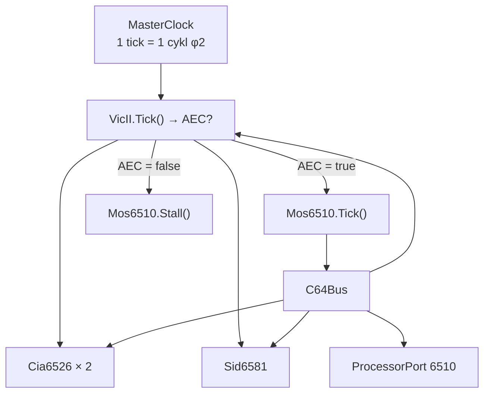
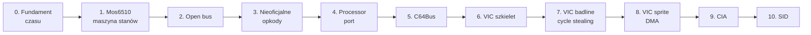

# Plan implementacji: C64 cycle-exact (6510 + VIC-II)

Status: **plan** · Target: **PAL 6569R5** · Zakres: **poziom 3** (gry + większość dem)

---

## 0. Definicja celu

„100% zgodności cyklowej" wymaga związania z konkretnym wariantem sprzętu. Przyjmujemy:

| parametr | wartość | uzasadnienie |
|---|---|---|
| Region | **PAL** (6569R5) | standard europejski, 50 Hz |
| Cykle / linia | **63** | |
| Linie / klatka | **312** | 63 × 312 = **19 656 cykli/klatkę** |
| Częstotliwość CPU | 985 248 Hz | 17 734 475 / 18 |
| Odświeżanie | 50,125 Hz | |
| CPU | **6510** (port `$00`/`$01`) | nie 6502 |
| Dokładność | cykl + wybrane efekty półcyklowe | poziom 3–4 |

**Kryterium końcowe:** emulator przechodzi zestawy VICE `testprogs` dla CPU i VIC-II oraz odtwarza
badline/sprite DMA z dokładnością do cyklu, potwierdzoną porównaniem logów z referencją.

**Poza zakresem (świadomie):** NTSC 6567, rewizje 6569R1/R3 (grey dot, inne idle), pełny model SID
(na razie rejestry + timing odczytów), emulacja stacji dysków.

---

## 1. Zasada nadrzędna: VIC-II jest masterem

Na C64 CPU **nie jest** sterownikiem. VIC-II pobiera dane z pamięci i wstrzymuje CPU przez linie `BA`
i `AEC`. To determinuje architekturę: CPU musi być **maszyną stanów**, którą można zatrzymać
w środku instrukcji.



Konsekwencja: `Cpu<TBus>.Step()` z `src/Core/Cpu` **nie może** być bazą. Zostaje jako referencja
funkcjonalna dla testów ALU (29 opkodów już zweryfikowanych) i jako punkt wyjścia do tabel.

---

## 2. Architektura docelowa

```
src/Core/C64/
  MasterClock.cs         # pętla klatki, 1 tick = 1 cykl, kolejność komponentów
  Mos6510.cs             # CPU jako maszyna stanów, AEC/Stall, pełne 256 opkodów
  Mos6510.Table.cs       # tabela opkodów: cykle bazowe + warianty (page cross, branch)
  UnstableOpcodes.cs     # ANE/LXA/SHA/SHX/SHY/TAS — zależne od open bus
  VicII.cs               # 63×312, BA/AEC, badline, sprite DMA, rendering
  VicII.Registers.cs     # $D000-$D3FF, mirror co 64 B
  VicII.Sprites.cs       # MC/MCBASE/DBUF, kolizje, priorytety
  VicII.Palette.cs       # 16 kolorów, warianty 6569R5
  OpenBus.cs             # ostatnia wartość na magistrali
  C64Bus.cs              # dekoder $0000-$FFFF + banking
  ProcessorPort.cs       # $00/$01, DDR, opóźnienie 3 cykli
  Cia6526.cs             # timery A/B, TOD, IRQ/NMI
  Sid6581.cs             # rejestry, timing odczytu (na razie bez syntezy)
  C64Machine.cs          # kompozycja: clock + cpu + vic + cia + sid + bus
```

---

## 3. Fazy implementacji

Każda faza ma **kryterium akceptacji** — bez niego nie przechodzimy dalej.

### Faza 0 — Fundament czasowy (bez logiki CPU)

**Zakres**
- `MasterClock`: pętla `while (Cycles < 19656) { ... }`.
- Pusta implementacja `VicII.Tick()` zwracająca `true` (CPU zawsze dostaje dostęp).
- `CpuState.Cycles` jako `long`.

**Pliki:** `MasterClock.cs`, `C64Machine.cs`

**Akceptacja**
- [ ] Klatka = dokładnie 19 656 ticków.
- [ ] 100 klatek = 1 965 600 ticków bez dryfu.
- [ ] Test: `Frame_HasExactly19656Cycles`.

---

### Faza 1 — Mos6510 jako maszyna stanów

**Zakres**
- `Tick()` wykonuje **jeden cykl**: fetch, operand, operand, execute — zależnie od `_step`.
- `Stall()` — cykl ukradziony: `Cycles++`, brak zmian rejestrów.
- Pełna implementacja 151 oficjalnych opkodów.
- Page crossing (+1 dla `abs,X`/`abs,Y`/`(zp),Y`) i branch penalty (+1/+2).
- Ghost byte: `abs,X`/`abs,Y` czyta spod adresu **bez** korekty strony.
- RMW: `read → write(old) → write(new)`.
- `JAM`/`KIL` (`$02`, `$12`, `$22`, …): zatrzymanie CPU, nie wyjątek.

**Pliki:** `Mos6510.cs`, `Mos6510.Table.cs`

**Akceptacja**
- [ ] Tom Harte `65x02` — **100%** dla 151 oficjalnych opkodów (stan końcowy + cykle).
- [ ] RMW generuje 2 zapisy, nie 1.
- [ ] `LDA $10FF,X` = 5 cykli z dummy read, `LDA $1000,X` = 4 cykle.
- [ ] Testy w `tests/VibeEmulator.Core.Tests/C64/`.

**Ryzyko:** to największy etap (~2 500 linii + dane testowe). Mitygacja: generowanie tabel z danych
Tom Harte, nie ręczne przepisywanie.

---

### Faza 2 — Open bus

**Zakres**
- `OpenBus`: rejestr „ostatnia wartość na magistrali", aktualizowany każdym odczytem.
- Odczyt z `$D400-$DFFF`, `$DE00-$DFFF`, `$DF00-$DFFF` zwraca open bus.
- Odczyt z `$01` w trybie output zwraca stan portu (mieszanka DDR/danych).

**Akceptacja**
- [ ] `LDA $D419` zwraca wartość zależną od poprzedniego dostępu.
- [ ] Dwa różne poprzedzające odczyty dają różne wyniki (dowód, że to nie stała).

**Dlaczego tak wcześnie:** bez tego nieoficjalne opkody z fazy 3 będą błędne.

---

### Faza 3 — Nieoficjalne opkody

**Zakres**
- Stabilne: `LAX`, `SAX`, `DCP`, `ISC`, `SLO`, `RLA`, `SRE`, `RRA`, `ANC`, `ALR`, `ARR`, `SBX`.
- Niestabilne, zależne od open bus: `ANE`, `LXA`, `SHA`, `SHX`, `SHY`, `TAS`.
- `LAS`, `SHS` — warianty adresowania.

**Akceptacja**
- [ ] Tom Harte `65x02` — 100% dla wszystkich 256 opkodów.
- [ ] Testy niestabilnych z jawnie ustawionym open bus (bez tego test jest niedeterministyczny).

---

### Faza 4 — Processor port 6510

**Zakres**
- `$00` = DDR, `$01` = dane. `$01` read zwraca `(data & ddr) | (~ddr & 0x17)`.
- Bankowanie: LORAM/HIRAM/CHAREN → 8 konfiguracji.
- **Opóźnienie 3 cykli** przy przełączeniu banków: zapis do `$01` wpływa na dostęp dopiero
  po 3 cyklach.

**Akceptacja**
- [ ] Zapis `$01` → odczyt `$A000` w cyklu 1 zwraca stary bank, w cyklu 3+ nowy.
- [ ] 8 konfiguracji bankowania ma pokrycie testami.
- [ ] I/O visible tylko gdy `(ddr & 0x04) != 0`.

---

### Faza 5 — C64Bus

**Zakres**
- Dekoder `$0000-$FFFF`: RAM, BASIC ROM, KERNAL ROM, CHAR ROM, I/O (`$D000-$DFFF`), cart.
- Mirrorowanie VIC: `$D000-$D3FF` co 64 bajty.
- Mirrorowanie CIA: `$DC00-$DCFF` co 16, `$DD00-$DDFF` co 16.
- Zapis do ROM → ignorowany (ale przechodzi przez open bus).

**Akceptacja**
- [ ] Mapa adresów zgodna z tabelą z „Mapping the C64".
- [ ] Wszystkie 8 konfiguracji bankowania × 4 regiony pokryte testami.

---

### Faza 6 — VIC-II: szkielet i raster

**Zakres**
- 63 cykle × 312 linii. `Tick()` zwraca `AEC`.
- Rejestry `$D011` (YSROLL, DEN, RSEL, BMM), `$D012` (raster), `$D016` (XSROLL, MCM), `$D018`.
- BA/AEC: brak na razie stealing.
- Przerwanie raster: porównanie `$D012` z licznikiem, flaga w `$D019`.

**Akceptacja**
- [ ] Raster rośnie 0→311 i zawija.
- [ ] `$D012` odczyt zwraca aktualną linię.
- [ ] Przerwanie raster zgłaszane w cyklu zgodnym z referencją.

---

### Faza 7 — VIC-II: badline i cycle stealing

**Zakres**
- Warunek badline: `DEN=1` ∧ `raster ∈ [0x30, 0xF7]` ∧ `(raster & 7) == YSROLL`.
- **BA opada w cyklu 12, AEC w cyklu 15, AEC wraca w cyklu 54.**
- **CPU wstrzymany przez 40 cykli** (15–54).
- Idle state: VIC czyta `$3FFF`, gdy DEN=0.
- GREY DOT: pierwszy piksel w trybie tekstowym, gdy `$D020` == `$D021`.

**Akceptacja**
- [ ] Linia z badline: CPU traci dokładnie 40 cykli.
- [ ] Linia bez badline: CPU traci 0.
- [ ] Border opener działa (test: otwarcie borderu przez zmianę `$D011` w cyklu 55+).
- [ ] Porównanie logu `(cykl, AEC)` z VICE dla 312 linii — identyczne.

**Ryzyko:** to serce zgodności. Bez tego nie ma „100%".

---

### Faza 8 — VIC-II: sprite DMA

**Zakres**
- Odczyt wskaźników sprite'ów w cyklach 55–62 (jeden na sprite'a).
- Warunek startu DMA: `raster == sprite.Y` ∧ `sprite.enabled`.
- MC/MCBASE/DBUF; 2 cykle na sprite'a przy pobieraniu danych.
- Kolizje sprite-sprite i sprite-background, rejestry `$D01E`/`$D01F`.
- Priorytety, multicolor, rozciąganie X/Y.

**Akceptacja**
- [ ] 8 sprite'ów na linii: liczba skradzionych cykli zgodna z referencją.
- [ ] Kolizja wykrywana w prawidłowym cyklu.
- [ ] Odczyt `$D01E` kasuje flagę.

**Uwaga:** dokładne przypisanie cykli do poszczególnych sprite'ów wymaga tabeli z dokumentacji
Bauera — **nie przepisywać z pamięci**, weryfikować z VICE.

---

### Faza 9 — CIA 6526 × 2

**Zakres**
- Timer A (3 tryby), Timer B (4 tryby, w tym zliczanie Timer A / CNT).
- Latch, force load, one-shot.
- TOD (zegar czasu rzeczywistego) + alarm.
- Przerwania: `$DC0D` (IRQ), `$DD0D` (NMI), bity maskujące.
- Porty A/B, kierunki.

**Akceptacja**
- [ ] Timer A w trybie one-shot zgłasza IRQ w prawidłowym cyklu.
- [ ] NMI z CIA2 generuje wektor `$0318`.
- [ ] TOD przechodzi przez północ.

---

### Faza 10 — SID (minimalny)

**Zakres**
- Rejestry `$D400-$D418`, mirror co 32.
- Odczyt `$D41B`/`$D41C` zwraca stan oscylatora (potrzebne grom).
- Timing zapisu (2 cykle).
- **Bez syntezy audio** — tylko model rejestrowy.

**Akceptacja**
- [ ] Zapisy/odczyty zgodne z mapą.
- [ ] Odczyt potencjometrów nie zawiesza gier.

---

## 4. Walidacja — co decyduje o „100%"

| zestaw | pokrywa | faza | kryterium |
|---|---|---|---|
| **Tom Harte 65x02** | 256 opkodów, stan + cykle | 1, 3 | 100% przechodzi |
| **Klaus Dormann** functional test | całościowe działanie CPU | 1 | kod sukcesu w `$0000` |
| **perfect6502** | referencja tranzystorowa | 1, 3 | zgodność stanu po każdej instrukcji |
| **VICE `testprogs/cpu`** | cykle, pułapki | 1, 4 | 100% |
| **VICE `testprogs/vicii`** | badline, sprite, timing | 7, 8 | 100% |
| **VSP bug test** | `$D011` na końcu linii | 7 | efekt odtworzony |
| **CIA timer tests** | tryby timerów | 9 | 100% |

Testy w repo: dane jako JSON w `tests/`, `[Theory]` + `[MemberData]`, **zero sieci**, deterministyczne.
Zgodne z `.github/instructions/csharp-tests.instructions.md`.

---

## 5. Budżet wydajnościowy

Z pomiarów w `tools/CycleModel` i `tools/EmuBench`:

| element | wartość |
|---|---|
| Cykle / klatkę | 19 656 |
| Koszt ticku (maszyna stanów, naiwna) | ~25 ns |
| Koszt klatki | **~490 µs** |
| Budżet 50 Hz | 20 000 µs |
| **Udział CPU** | **2,5%** |

Wniosek: 100% zgodności cyklowej **nie jest ograniczeniem wydajnościowym**. Pozostałe 97% budżetu
zostaje na VIC-II rendering i SID.

---

## 6. Ryzyka

| ryzyko | wpływ | mitygacja |
|---|---|---|
| Niepełna dokumentacja niestabilnych opkodów | błędy w demach | testy na Tom Harte + `perfect6502` |
| Różnice rewizji VIC-II | efekt widoczny w <1% softwaru | świadomie poza zakresem (6569R5) |
| Timing sprite DMA z pamięci | błędne cykle | tabela z Bauera + porównanie z VICE |
| Złożoność fazy 7 | opóźnienie całego projektu | osobne testy per-linia, nie per-klatka |
| Brak ROM-ów w repo | brak testów end-to-end | ROM-y nie trafiają do repo; testy na wektorach |

---

## 7. Kolejność wykonania



**Kamienie milowe:**

| kamień | warunek |
|---|---|
| M1 | Pełny 6510 przechodzi Tom Harte 100% (oficjalne + nieoficjalne) |
| M2 | Badline kradnie dokładnie 40 cykli, log zgodny z VICE |
| M3 | Sprite DMA zgodny z VICE dla 8 sprite'ów |
| M4 | Przechodzi `vice testprogs` dla CPU i VIC-II |
| M5 | Uruchamia się prosta gra (bez SID audio) |

---

## 8. Co zostaje z obecnego kodu

| element | decyzja |
|---|---|
| `src/Core/Cpu/*` (29 opkodów, kompozycja) | **zostaje** jako referencja ALU i baza tabel |
| `MemoryMap`, `OpcodeTable`, `CpuBuilder` | wzorce do ponownego użycia |
| `ref CpuState` (zweryfikowane 11,8 ns/instr.) | wzorzec wydajnościowy |
| `tools/CycleModel` | **zostaje** jako dokumentacja różnicy modeli czasu |
| `Cpu<TBus>.Step()` jako baza C64 | **odrzucone** — brak możliwości stallu |
| `src/Core/Fibonacci.cs`, `tools/Bench` | poza zakresem, zostają |
